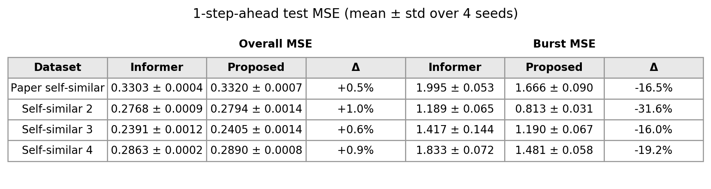
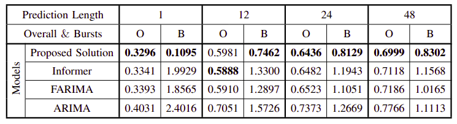
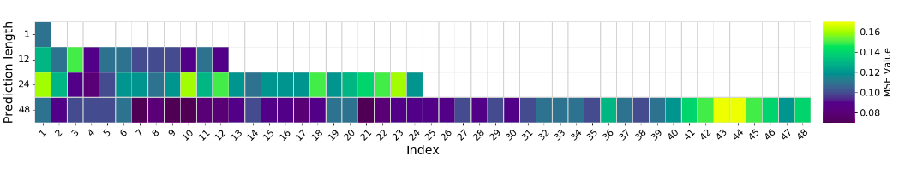
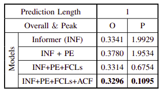

# Burst Aware Forecasting of User Traffic Demand in LEO Satellite Networks

This is the repo for the ``Burst Aware Forecasting of User Traffic Demand in LEO Satellite Networks" paper.

## Detected data leak

We recently found a data leak in how the original flow loaded the decoder's burst feature. The flow used in the paper had

```python
seq_y_peaks = self.dists[r_begin:r_end]
```

The decoder window `[r_begin, r_end)` includes the forecast horizon `[s_end, r_end)`, and this part was not masked in the forward pass. As a result, the decoder received the distance-to-burst feature at the very steps it was forecasting, which reveals when the next burst occurs.
In addition, Eq. (3) uses future values to label a burst, which is not possible in real-time operation. This is a minor leak, but the recent updates address it as well: bursts are now labelled from past samples only, with thresholds fitted on the training region. The original flow is kept as `--peak_feature leak` for comparison; the default is the leak-free `--peak_feature causal`.

After these changes, we trained the proposed model and vanilla Informer on the dataset used in the paper and on three more self-similar datasets, each with four training seeds. The 1-step-ahead (H=1) results are as follows:



These runs used a 4 GB GPU, with batch size 64 and 2 gradient accumulation steps. They can be reproduced with `bash final_study/run_final.sh`.

At H=1, the proposed model still reduces burst MSE by 16-31%, but this is below the 94% found with the original flow. Unfortunately, the gain fades away at H=24 and H=48, and Fig. 4 of the paper could not be reproduced with leak-free training. At H=12 there still seems to be some gain, and we will post an update on it.

The rest of this README is kept as it was: the figures and tables below come from the original flow and are still provided for comparison.

## Required packages
Python 3.7.17 is used alongside the libraries provided in requirements.txt

## Changes over standard Informer architecture

Three main changes can be seen under 
1) models/embed.py and data/data_loader.py for Peak embedding
2) models/model.py for the additional Fully Connected Layers
3) exp/exp_informer.py for the asymmetric training loss

The rest of the codebase is in parallel with standard informer architecture

## Dataset

Used dataset is provided under data/ETT as the 1.04_750_10ms.csv and bursts177.csv
The three additional self-similar datasets are under data/fresh as self_similar_{2,3,4}.csv, with their burst labels in self_similar_{2,3,4}_peaks.csv
get_bursts.py is used to find the burst locations


## Old results (original flow, with the data leak)





## Acknowledgement
Most of the codebase is derived from the following main repo:

https://github.com/zhouhaoyi/Informer2020